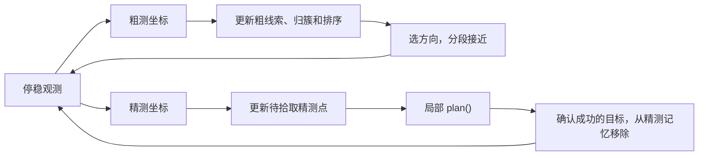
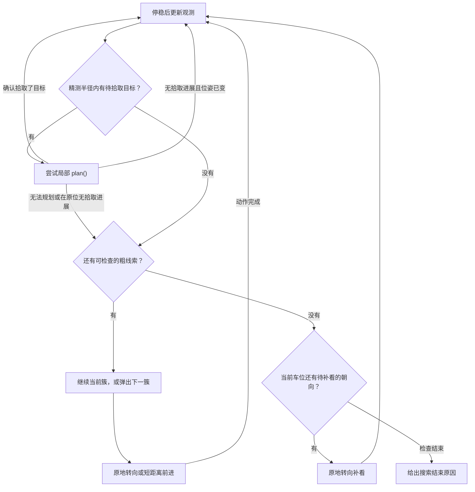

# CoveragePolicy 聚类搜索算法

`CoveragePolicy` 在一次任务中逐步决定去哪里观察、何时局部拾取以及何时结束搜索。本文描述当前的聚类模式，簇半径设为 1.6 m。

## 粗测找区域，精测做拾取

粗测坐标只影响搜索。粗点和精点分别记忆，各自做同类型坐标关联。两者之间的坐标偏差不会影响精测点进入 `plan()`。局部规划器接收当前位姿、精测目标及几何约束，每次独立处理一份静态快照。 [观测记忆](../planner/src/route_plan_planner/direction_policy.py#L416) · [拾取批次](../planner/src/route_plan_planner/direction_policy.py#L817)

| 参数 | 示例值 | 几何含义 |
| --- | --- | --- |
| 簇半径 `cluster_radius_m` | 1.6 m | 以簇锚点为圆心，用于归入粗测点 |
| 精测半径 `precision_range_m` | 1.4 m | 以当前车辆参考点为圆心，用于筛选精测拾取目标 |
| 局部运动半径 `auto_fence_radius_m` | 1.4 m | 以本批规划起点为圆心，约束本批车身参考点的轨迹 |
| 发现视距和视角 | 5 m、90° | 仿真用于生成观测。策略用视角判断环视覆盖，用视距限制单次接近循环 |

## 归簇和选簇

1. **更新记忆。** 同一类型的新旧观测按距离从小到大做一对一关联，一条旧记录在同一批观测中最多匹配一次。粗点关联容差默认 0.25 m，用来避免同一条线索反复计入密度。精测点用独立的 `position_match_tolerance_m`。
2. **固定锚点。** 粗点 `(x, y)` 到锚点 `(ax, ay)` 的距离为 `hypot(x - ax, y - ay)`。距离不超过簇半径即可归入。新点落在多个簇内时取最近的锚点，落在所有簇外时以它为锚点建簇。已经关联到旧记录的点在原簇半径内沿用原归属。
3. **按密度出堆。** 半径相同，直接用待检查粗点数比较密度。需要换簇时按 `(-待检查点数, 到锚点距离, 绝对转角, 簇 ID)` 重建最小堆并弹出首项。出堆后成为当前簇。同一任务里每个簇 ID 最多出堆一次，簇锚点继续供后续观测归属使用。

例如，簇 A 有 5 条待检查线索，簇 B 有 2 条，先搜索 A。若接近 A 时精测到 2 件，先规划拾取这 2 件。拾取后重新观察，然后继续检查 A 的剩余线索。A 处理完时按最新密度决定下一个簇。 [簇记忆与出堆](../planner/src/route_plan_planner/cluster_memory.py)

粗线索记忆与出堆由独立的 `ClusterMemory` 实现。自动搜索和外部流程都可以用 `remember(points)` 更新记忆，用 `next_cluster(pose)` 主动弹出密度最高的簇。

## 分段接近和精测拾取

**接近粗线索。** 簇内按 `距离 + 0.25 × 绝对转角` 选线索，角度用弧度。每次先对准方向，再前进。若粗点距车为 `d`，精测半径为 `r`，首选步长为 `min(0.40, max(0.15, d - r + 0.15))` 米，直行受阻可以尝试半步。成功转向或前进后重新观测，一旦有近处精测点，就暂停粗线索搜索。 [接近逻辑](../planner/src/route_plan_planner/direction_policy.py#L445)

**规划精测批次。** 搜集当前精测半径内的所有已测、尚未确认拾取的点。这个集合可以包含当前簇以外的目标，也可以包含本帧未看到但已保留在记忆里的精测点。用 `stops` 和 `auto_fence` 模式求路线与拾取停靠。同一实测位姿和精测点集反复出现时，复用最近一次相同尝试的结果。确认拾取成功后，只移除本批确认成功的精测点，再重新观测。 [精测目标筛选](../planner/src/route_plan_planner/direction_policy.py#L697) · [批次规划](../planner/src/route_plan_planner/direction_policy.py#L817)

**判断粗线索何时处理完。** 当前没有近处精测待拾取点时，位于精测半径内、偏角不超过 `0.4 × 发现视角` 且本帧未再出现的旧粗线索，记为已检查。以 90° 发现视角为例，偏角范围为车头左右各 36°。新粗测可以撤销这个标记。接近受阻或尝试耗尽也会结束对单条线索的本轮尝试，未确认的记录仍可出现在结束结果中。当前簇没有待检查线索后，才换到下一簇。 [线索检查条件](../planner/src/route_plan_planner/direction_policy.py#L497)

## 最后一次环视

没有可选簇时，算法在当前车位把一周均分为 `ceil(360° / 发现视角)` 个候选朝向。排除视野增量不超过 1° 的方向，每次选转角最小的候选补看。换车位或成功拾取后会重新记录已观测方向。环视中看到精测目标时继续拾取，看到可进入队列的新簇时继续搜索。 [补扫与结束判断](../planner/src/route_plan_planner/direction_policy.py#L507)

| 结束原因 | 含义 |
| --- | --- |
| `no_observed_targets` | 当前环视结束，未留下待处理精测点或待确认粗线索 |
| `unresolved_cluster_hints` | 仍有待确认的粗线索 |
| `unresolved_precise_targets` | 仍有未确认拾取的精测目标 |
| `incomplete_final_scan` | 末尾环视仍有未能检查的朝向 |
| `round_limit` | 达到策略轮数上限 |

整场是否清空取决于观察覆盖和可达性。簇出堆记录搜索顺序，物品是否已拾取以实际拾取确认为准。
