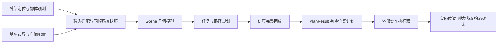

# 系统输入输出与集成接口

实现基线：提交 `b87635c`，包含静态任务规划、路径长度优化和直径 10 cm 圆形目标规则。

现已增加面向业务集成的纯算法 SDK，提供 `PlanningRequest → plan() → PlanningResponse`，可独立安装，见 [Python SDK 说明](python-sdk.md)。下文保留原生 `Scene` / CLI 格式，便于开发和复现；一般跨工程集成优先使用 SDK。

当前最适合按无窗口 Python 规划模块集成：输入一份静态场景快照，输出按顺序执行的 map 目标位姿。规划器内部依赖 `Scene` 的几何试算，但 Python 规划调用不要求创建 IR-SIM 窗口。

目前已有 Python 调用、纯算法 SDK 与仓库内文件式 CLI；没有 HTTP/RPC 服务、ROS 节点、实车控制器或感知反馈适配器。本文先列出原生接口，最后给出业务集成边界。

## 1 数据流与职责



`Scene`、规划器、仿真回放及 `PlanResult` 已实现。连接外部定位和感知的适配器、实车执行器及实际反馈处理需要集成方补充。

## 2 规划输入

### 2.1 业务数据

| 输入 | 现行表示 | 单位与约定 |
| --- | --- | --- |
| 地图边界 | `world.width`、`world.height` | 米，轴对齐矩形，内部原点为 `(0,0)` |
| 当前车辆位姿 | `pose = (x,y,yaw)` | 米、米、弧度；参考点和旋转中心均为车身中心 |
| 待消除物体 | `remaining = {id: (x,y)}` | 整数 ID 到圆心坐标的映射，全部处于同一 map 坐标系 |
| 物体尺寸 | `target_diameter` | 米，当前所有物体共用同一直径，默认 0.10 |
| 已消除物体 | `collected = {id: (x,y)}` | 可为空；不能与剩余目标 ID 重复 |
| 车辆与消除器几何 | `vehicle_config` | 车长宽、消除区宽深、安装偏移、每侧安全外扩 |
| 速度参数 | `motion.forward_speed`、`angular_speed` | 米/秒、弧度/秒，供仿真执行和动画使用 |
| 规划方法与预算 | 规划器类型及 `PlannerOptions` | 可行性或长度优化、搜索时限、试算与展开上限等 |

默认车辆为车身 0.50 × 0.60 米，消除区宽 0.35 米、深 0.24 米，每侧外扩 0.10 米。安装位置暂按居中紧贴车头；参数来源为 [robot.yaml](../sim/config/robot.yaml)，不在集成代码中再复制一套默认几何。

### 2.2 坐标与输入限制

- 所有位姿和圆心必须在同一坐标系中。0° 向右、90° 向上、逆时针为正。Python 和 JSON 的 yaw 使用弧度，界面输入框才使用度。
- 当前地图只包含矩形边界和待清除圆形目标，没有独立的固定障碍物列表、栅格代价地图或任意多边形工作区输入。地图 `offset` 仅支持零。
- 目标圆必须完整处于地图内，不能接触当前车辆安全轮廓。允许重叠与重合圆心；重叠连通组在消除器首次接触任意成员时一次全部清除，仅相切不分组。清除前仍检查全部成员圆的碰撞范围，保留全部目标 ID。
- 当前目标尺寸是全局统一值，不支持每个 ID 单独指定半径。
- JSON 中整数 ID 会作为字符串对象键保存，恢复时转换回整数。外部 UUID 或任意字符串 ID 需要适配层建立映射。
- 当前阶段在规划期间假设场景不变，没有目标更新版本、时间戳校验或自动感知重规划机制。

内部原点、坐标轴或位姿参考点与外部系统不同时，应在输入适配层转换。尤其要确认外部定位参考点是否等于当前模型的车身中心。

### 2.3 输入场景的现有构建方式

规划器直接接收 `Scene` 对象：

```python
result = StaticPlanner(options).plan(scene)
result = LengthPlanner(options).plan(scene)
```

`Scene` 的初始化入口首先面向仿真预设，会根据 `front / surround / random` 生成目标。接入自定义观测时，可使用现有 `restore_scene(record)`，它从完整配置和指定状态重建场景，保留目标 ID，并在放入观测前将随机生成数量置零。

现行可接受的原生场景记录结构为：

```text
{
  "world_config": {完整地图与场景配置},
  "vehicle_config": {完整车辆配置},
  "state": {
    "pose": [x, y, yaw],
    "remaining": {"101": [x1, y1], "205": [x2, y2]},
    "collected": {},
    "failure": null,
    "scenario": "random",
    "seed": 42,
    "target_diameter": 0.10
  }
}
```

上面是结构说明，不是省略字段后也能直接运行的 JSON。完整可运行示例见 [integration_scene.json](../planner/examples/integration_scene.json)，其中两个目标 ID 为 101、205。

`world_config.custom.target_diameter` 与 `state.target_diameter` 同时出现时必须一致。旧归档如果两处均没有尺寸，按原点模型，即直径 0，恢复；新的观测输入应始终显式保存尺寸。

重建时，当前位姿以 `state.pose` 为准，车辆几何以 `vehicle_config` 为准；`state.dimensions` 是快照信息，不是修改车型的入口。自定义目标以 `state.remaining` 为准，`scenario`、`seed` 作为现有场景元数据保留，不会替代输入目标重新生成一批点。

目标接触当前消除区时，模型会立即将其视为已消除，因此不能把这种目标直接作为原生记录的 `remaining` 恢复。真实拾取确认和模型初态的对应关系应由适配层确定。

## 3 规划输出

### 3.1 PlanResult

| 字段 | 类型 | 集成含义 |
| --- | --- | --- |
| `status` | 字符串 | 是否得到通过仿真验证的完整计划 |
| `goals` | `[(x,y,yaw), ...]` | 有序 map 目标位姿，供执行器逐条消费 |
| `length` | 浮点数 | 米，整份计划的车辆中心总平移距离，原地转向不计路程 |
| `elapsed` | 浮点数 | 秒，规划及验证耗时，不是实车执行时间 |
| `remaining` | 整数 | 最终回放的剩余数量；未执行有效回放时可能保留输入数量 |
| `final` | 状态字典或空 | 仿真预测的终态，含位姿、剩余和已消除集合、尺寸、失败原因 |
| `reason` | 字符串或空 | 失败或未找到解的原因 |
| `expanded / trials / ompl_calls / backtracks` | 计数 | 搜索诊断，不用于控制车辆 |
| `best_remaining / diagnostic` | 数量与诊断字典 | 搜索曾达到的进展；部分试算路径不是完整可执行计划 |
| `optimization` | 字典或空 | 初解长度、节省长度、改进次数、优化结束原因等 |

`result.to_dict()` 可得到可序列化的结果字段。**`success` 表示仿真中存在并验证了一条全部清除的计划，不代表实车已经到达或完成拾取。** `final.collected` 和 `remaining=0` 同样是仿真预测，不应直接写入真实任务的完成状态。

### 3.2 状态处理

| `status` | 含义 | 调用方处理 |
| --- | --- | --- |
| `success` | 找到完整且回放安全的方案 | 可以进入外部执行流程，继续依靠实际反馈确认完成 |
| `invalid_input` | 规划器检测到初始场景已有失败状态 | 修复输入后重新构建场景 |
| `budget_exhausted` | 未取得完整方案，搜索预算耗尽 | 不执行部分路径；可调整预算或输入后重新规划 |
| `not_found` | 有限候选搜索结束，未找到完整方案 | 不等于已证明无解，保留诊断 |
| `replay_failed` | 候选完整方案未通过最终回放 | 不执行，记录输入与原因排查 |

配置、非法观测、错误 JSON 或不匹配的初解也可能在构建场景或调用时抛出异常，不会全部转换成 `PlanResult.status`。Python 集成需要分别处理输入构建失败和规划结果。

长度优化预算耗尽时，只要保留了完整可行初解，顶层仍是 `success`；具体结束原因在 `optimization.termination`。不能因为该字段包含 `budget_exhausted` 就丢弃顶层成功方案。

### 3.3 goals 的执行语义

`goals` 包含车辆位姿，不是物体圆心列表，也不是单纯的拾取顺序。它可能包含：

- 同位置、不同 yaw 的纯转向目标。
- 为提前对准或绕行设置的中间位姿。
- 到达后有多个目标被消除的接近位姿。

每条目标位姿对应“原地转向目标位置 → 向前直线到达位置 → 原地调整最终 yaw”。新目标会替换控制器旧指令，所以必须逐条下发，完成一条后再发下一条。

完整序列已经编码了必要的预转向与较长方向转向，不应自行合并同位置的 yaw 目标。将其交给会平滑曲线、边走边转或改道的执行器时，实际轨迹可能偏离已验证运动，需重新适配与验证。

当前没有输出带时间戳的轨迹、轮速、`cmd_vel`、机械拾取动作或消除器开关指令。旧 `feasibility/length` 模式按运动接触消除。新增 `stops` 模式则在 `pickup_stops` 指定的服务位姿才消除；原生结果和 SDK 均提供从 0 开始的 `goal_index` 及对应目标 ID，SDK 另有 `stop_count`。SDK 的 `PlanningResponse.steps` 提供逐位姿的预计清除 ID，停靠模式只在服务位姿处非空。实际执行必须先到达完整位姿，再处理并确认该批目标，之后继续路线。上述均为模型预测。

## 4 Python 与 CLI 的最小调用

### 4.1 无窗口 Python

```python
import json
from route_plan_planner import LengthPlanner, PlannerOptions
from route_plan_planner.records import restore_scene

with open("planner/examples/integration_scene.json", encoding="utf-8") as file:
    request = json.load(file)

scene = restore_scene(request)
result = LengthPlanner(PlannerOptions(timeout=3.0)).plan(scene)
response = result.to_dict()

if result.status == "success":
    ordered_map_goals = result.goals
    # 交给外部执行器；实际完成依靠外部反馈确认。
```

`plan()` 不修改传入的场景。模块导入与无窗口规划不会创建 IR-SIM 窗口；绘图和交互演示按需加载。

### 4.2 文件式 CLI

从仓库根目录执行：

```bash
uv run --project planner --locked route-plan solve \
  --input planner/examples/integration_scene.json --method length --timeout 3 \
  --output sim/output/integration-demo/plan.json
```

输入既可以是原生场景记录，也可以是已有完整运行记录，后者会取其中的 `initial`。重新求解的方法和预算由本次 CLI 参数决定，不会自动采用输入运行记录中的 `planner` 或 `options`。输出文件结构为：

```text
{
  "schema_version": 1,
  "planner": "length-beam-v1",
  "python": "运行时版本",
  "options": {规划参数},
  "geometry": {目标形状 直径 车辆尺寸},
  "initial": {本次完整原生场景记录},
  "result": {PlanResult 字段},
  "length_options": {长度优化参数}
}
```

`length_options` 仅在长度优化方法下提供。成功正常返回退出码 0；未找到完整方案返回 1；CLI 捕获的输入或文件错误使用 argparse 错误退出码 2。stdout 是人读日志，机器应解析 `--output` 指定的 JSON。更早发生的配置读取异常等也可能以异常形式终止，不能只依赖日志文本判断原因。

`--timeout` 是搜索预算，最终回放会增加耗时，不能作为严格的接口返回期限。当前 Python 规划调用是同步调用，未提供中途取消或进度事件接口；有响应时限的上层需要自行安排后台任务或工作进程。

同一个规划器实例会保存本次搜索的内部状态，首版集成应按请求新建规划器和场景，避免在同一实例上并发调用。OMPL 的随机流也具有进程级状态，批量调度与复现应保留完整输入和计划记录。

## 5 仿真执行与真实执行的边界

已有 `PoseController.set_goal()`、`step()`、`paused`、`stop()` 用于仿真执行。仿真调用方式为：

```python
from route_plan_sim import PoseController

controller = PoseController(scene)
for goal in result.goals:  # 仅在 status == "success" 时执行
    controller.set_goal(*goal)
    while controller.command is not None and scene.failure is None:
        controller.step(0.04)
    if scene.failure is not None:
        break
```

这里 `step()` 直接推进理想几何状态，不是读取实车定位后生成速度指令的闭环控制器。真实执行需另外提供实际位姿、到达结果、执行失败和拾取确认。实际轨迹偏差、目标更新或几何变化使计划失效时，目前没有自动闭环处理流程。

`scene.reset()` 恢复预设或随机场景，不负责还原任意外部观测列表。自定义观测的重试或回放应从保存的原输入重新构建 `Scene`。

## 6 建议的首版集成边界

建议先保留算法作为同步 Python 内核，在外面增加一个薄适配层：外部观测和配置转换为内部场景，调用规划器，再将成功的有序目标交给独立执行器。感知更新、任务生命周期与真实完成确认由上层管理。

首版可采用停车采集一帧状态、规划期间保持车辆静止、核对起始状态后开始执行的流程。外部系统需约定实际位姿偏差和计划失效的处理方式，当前内核没有自动检查实车是否仍处于规划起点的接口。

现有 SDK 业务请求已提供 `request_id`、`frame_id`、当前位姿、目标列表和几何配置；响应返回相同关联标识、规划状态、目标序列及每步预期拾取 ID。标识用于关联，不执行坐标变换或场景版本校验；观测时间、场景更新、真实到达和拾取确认仍需外部适配。原生 JSON 记录继续用于规划与复现。

开始对接时需要先确定外部坐标系与车辆参考点、目标 ID 映射、地图表达，以及执行器能否保持现有转向和前进规则。随后再约定实车到达与拾取确认反馈，形成完整任务闭环。
