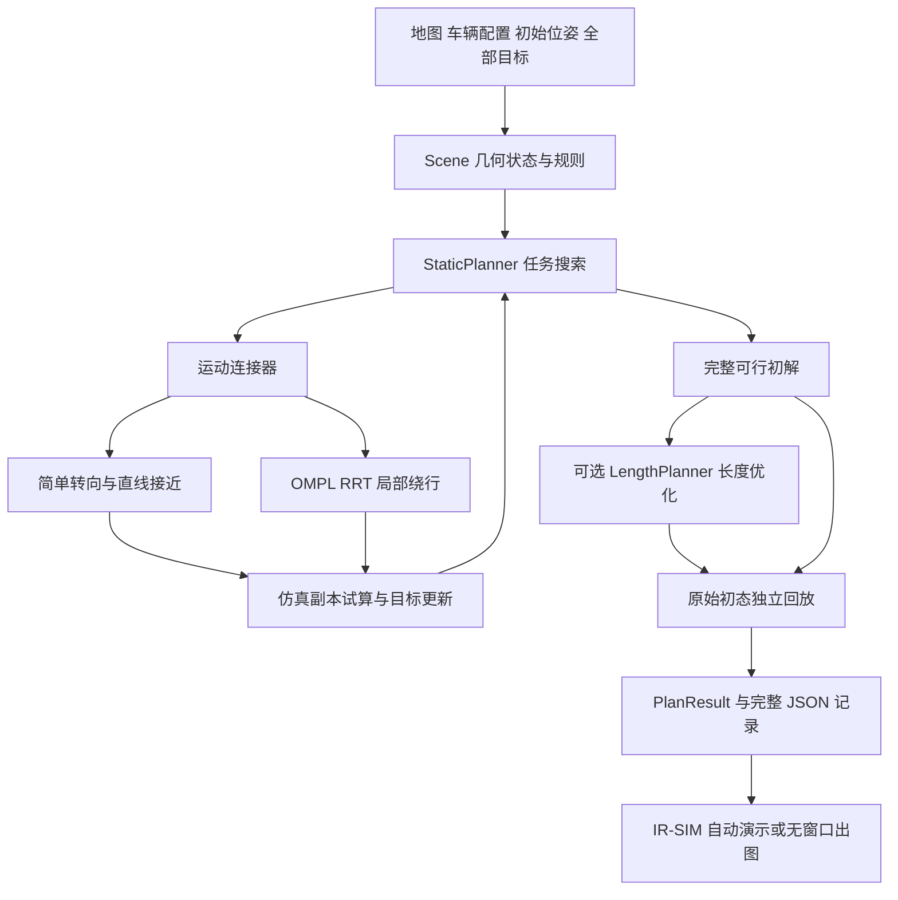

# 现行技术方案 v0.2.0

实现基线：Git 标签 `v0.2.0`，提交 `2631d0c`。规划器包版本为 `0.2.0`，仿真包版本为 `0.1.0`。本文描述该版本已经落地的技术实现；分阶段开发安排见 [规划路线](planning-roadmap.md)。

现行方案采用“任务搜索 + 运动连接 + 连续几何仿真验证”的结构：先找到能够安全清空全部目标的动作序列，再按需在剩余预算内缩短总行驶距离。任务与路径规划共同考虑剩余目标状态，最终方案从原始初态重新回放通过后，才用于自动演示。

## 1 任务范围与优化目标

当前处理静态完整准确观测：启动时已知全部目标的位置和标识，执行期间没有新增、漏检补充、位置修正或外部删除。目标位置固定，其未消除或已消除的状态随车辆动作变化。

根本目标是全部清除，且全过程满足运动、碰撞与边界规则。在此基础上，以车身中心的总平移路程为优化目标：

\[
\min L=\sum_{k=1}^{m}\sqrt{(x_k-x_{k-1})^2+(y_k-y_{k-1})^2}
\]

其中，序列包含实际下发的目标位姿。原地转向的平移距离为零，不额外加入角度或耗时惩罚。起始位姿固定，最终位置与朝向自由，不要求回到起点。采用有限预算下的工程优化，不要求全局最优。

| 方法 | 入口 | 行为 |
| --- | --- | --- |
| 可行性 baseline | `--method feasibility`，默认 | 找到首个完整、安全方案后停止 |
| 路径长度优化 | `--method length` | 保留可行初解，继续尝试更短方案；没有改进时返回原方案 |

核心算法组合如下。任务层和运动层分别保留接口，便于后续更换方法：

| 层次 | 当前算法 | 解决的问题 |
| --- | --- | --- |
| 任务可行性 | 启发式排序的深度优先搜索 DFS，保留分支回溯 | 消除谁、从哪里接近、顺序失败后如何换方案 |
| 简单运动 | 原地转向、直线前进、末端转向的几何连接 | 如何将两个车辆位姿合法连接 |
| 局部绕行 | OMPL 的 RRT，配合自定义运动边检查 | 简单连接受阻时，如何寻找中间位姿 |
| 路程改进 | 路径捷径、2-opt 顺序调整、接近位姿重建 | 如何减少已有可行方案的路程 |
| 候选继续搜索 | 有限宽度束搜索 Beam Search，以 `g+h` 排序 | 在剩余时间里探索其他较短的任务与路径分支 |

## 2 状态与车辆模型

任务搜索的几何状态为：

\[
s=(x,y,\theta,R)
\]

`(x,y,θ)` 是 map 坐标系下的车辆位姿，`R` 是剩余目标 ID 集合。目标 ID 到坐标的映射在一次静态任务中固定。地图和车辆配置也是该任务的固定输入。

同一位姿下，剩余目标不同，后续可行运动可能不同；因此搜索不能仅记录位置和朝向。连续未消除移动次数另作为搜索限制状态保存，不代表车辆的物理状态。

所有长度使用米，Python API 的角度使用弧度。车体 x 轴向前、y 轴向左；map 的 0° 向右，90° 向上，逆时针为正。

车辆参数统一来自 [robot.yaml](../sim/config/robot.yaml)：

| 参数 | 默认值 |
| --- | --- |
| 实体车身长、宽 | 0.50、0.60 米 |
| 每侧安全外扩 | 0.10 米 |
| 外扩后的安全矩形长、宽 | 0.70、0.80 米 |
| 消除区横向宽、前向深度 | 0.24、0.35 米 |
| 前进、转向速度 | 0.6 米/秒、1.2 弧度/秒 |

位姿参考点与旋转中心暂定为车身中心，消除器暂定为居中、紧贴车头。这些是当前仿真假设，尚不属于已确认的实车测量。配置支持消除器前向间距 `gap` 和横向偏移 `lateral_offset`。

### 坐标变换与轮廓公式

设目标的 map 坐标为 `(tx,ty)`，车辆位姿为 `(x,y,θ)`，目标在车体坐标系中的坐标为：

\[
u=(t_x-x)\cos\theta+(t_y-y)\sin\theta
\]

\[
v=-(t_x-x)\sin\theta+(t_y-y)\cos\theta
\]

矩形碰撞与消除检查均在这个局部坐标系中完成。记车长、车宽为 `Lb、Wb`，安全外扩为 `mb`；消除区宽、深为 `Wc、Dc`，安装间距和横向偏移为 `gc、oc`，则：

\[
B_{safe}=
[-L_b/2-m_b,\;L_b/2+m_b]
\times[-W_b/2-m_b,\;W_b/2+m_b]
\]

\[
C=[L_b/2+g_c,\;L_b/2+g_c+D_c]
\times[o_c-W_c/2,\;o_c+W_c/2]
\]

点接触矩形内部或边界均算接触。`EPS=1e-9` 用于浮点计算容差；实际安全外扩由 `body_margin` 决定。

## 3 总体结构与模块分工



| 模块 | 实现位置 | 职责 |
| --- | --- | --- |
| 几何规则引擎 | [scene.py](../sim/src/route_plan_sim/scene.py) | 位姿、目标状态、连续消除与碰撞、场景复制 |
| 位姿执行器 | [control.py](../sim/src/route_plan_sim/control.py) | 将目标位姿拆成原地转向和直线前进 |
| 任务搜索 | [core.py](../planner/src/route_plan_planner/core.py) | 候选接近位姿、消除顺序、分支回溯、预算控制 |
| 简单运动连接 | [motion.py](../planner/src/route_plan_planner/motion.py) | 合法转向、前进、提前对准、回放与距离计算 |
| 局部绕行 | [ompl_motion.py](../planner/src/route_plan_planner/ompl_motion.py) | 使用 OMPL RRT 连接局部位姿，以仿真规则检查运动边 |
| 路径长度优化 | [length.py](../planner/src/route_plan_planner/length.py) | 路径捷径、顺序调整、接近位姿重建、有限宽度搜索 |
| 输入输出与演示 | `records.py`、`cli.py`、`visualize.py` | 记录、重建、命令行、自动执行与对比图 |

算法在独立的 `planner/` 包中，仿真规则与显示适配在 `sim/` 包中。`TaskPlanner` 和 `MotionBackend` 协议允许分别替换任务搜索与运动规划方法。

IR-SIM 负责显示与外部步进下的位姿同步；目标由 `Scene` 管理并叠加绘制，不在 IR-SIM 的普通障碍物列表中。几何有效性与目标消除以 `Scene` 的计算为准。PythonRobotics 是前期算法思路参考，当前没有作为运行依赖接入；OMPL 是实际使用的运动规划依赖。

## 4 运动执行与安全验证

### 4.1 目标位姿与运动原语

一条目标位姿指令按以下顺序执行：原地转向目标位置、向前直线到达位置、原地调整最终朝向。禁止倒车，也不采用边走边转的运动模型。

每条位置目标必须处于当前车头前半平面：

\[
(x_g-x)\cos\theta+(y_g-y)\sin\theta\geq0
\]

正侧方允许，同位置可只调整朝向。处理后方目标时，规划器先下发合法的同位置转向指令，再下发前方的位置目标；不会绕过控制器检查。

简单连接器先尝试较短转向方向；该方向碰撞时，尝试另一转向方向。长转向拆成不超过 90° 的同位置目标，保持实际执行可复现。搜索中的分支回溯发生在内存中的仿真副本，不表示车辆后退。

### 4.2 碰撞与消除事件

目标是数学点，图上圆点大小不代表实体半径。消除区在前进和旋转中都有效，接触其边界也可消除，一次动作可以消除多个点。

未消除点不能接触安全矩形的内部或边界；安全矩形和消除区都不能接触地图边界。对每段运动，几何引擎解析计算目标点与矩形边界的首次接触时刻：直线运动求线性边界交点，原地旋转求三角方程的接触时刻；地图边界检查同样覆盖轮廓扫掠过程。

按时间先后处理事件：先进入消除区的点，不再参与后续车身碰撞；同一点同时接触安全轮廓与消除区时，碰撞优先。碰撞或越界时冻结在首次接触处，取消余下动作，重置后才能继续。

令 `τ∈[0,1]` 表示一段动作的完成比例，直线前进距离为 `d≥0`，则目标相对车辆的局部轨迹为：

\[
u(\tau)=u_0-\tau d,\qquad v(\tau)=v_0
\]

当 `d>0` 时，与矩形前后边界 `u=e` 接触的候选比例为 `τ=(u0-e)/d`。实现中还检查区间端点及点是否确实落在矩形范围内。

原地旋转相对角度为 `φ` 时：

\[
u(\tau)=u_0\cos(\tau\varphi)+v_0\sin(\tau\varphi)
\]

\[
v(\tau)=-u_0\sin(\tau\varphi)+v_0\cos(\tau\varphi)
\]

与矩形边界的接触可以统一为 `a cos(τφ)+b sin(τφ)=c`。令 `ρ=√(a²+b²)`、`β=atan2(b,a)`，当 `ρ>0`、`φ≠0` 且 `|c|≤ρ` 时，候选解为：

\[
\tau=\frac{\beta\pm\arccos(c/\rho)+2k\pi}{\varphi},
\qquad k\in\mathbb Z
\]

筛选 `0≤τ≤1` 且确实接触矩形的解，得到首次接触比例。零旋转、零距离等退化情况单独处理。

设同一点首次接触消除区和安全矩形的比例分别为 `τc、τb`，仅当 `τc+EPS<τb` 时才先按消除处理。再与地图接触及其他点碰撞的时刻比较，只应用全局停止时刻之前允许发生的消除事件。

防止跨帧穿透依靠完整运动段的解析检查。0.04 秒回放步长用于重新执行与状态验证，不是唯一的碰撞采样依据。

### 4.3 独立试算与回放

`Scene.clone()` 复制当前场景，配置、剩余目标、已消除目标和轨迹均不共享可变状态，也不重新读取磁盘文件。候选动作只在副本中执行，不会提前改变待演示场景。

试算使用同一个 `PoseController`，通过一次较大的时间预算执行完整目标位姿；找到完整方案后，再从原始初态按 0.04 秒步长逐步回放。这里的独立回放是重新执行整份计划，仍复用相同的规则引擎，不是另一套独立碰撞算法。

## 5 可行性任务搜索

### 5.1 生成接近位姿

规划目标是使目标点落入前置消除区，不能直接将目标点当作车身中心目的地。

对目标点 `p=(tx,ty)`、候选朝向 `α`、消除区中的前向距离 `d` 和横向中心偏移 `o`，生成车辆位姿：

\[
q_g=(t_x-d\cos\alpha+o\sin\alpha,\quad
t_y-d\sin\alpha-o\cos\alpha,\quad\alpha)
\]

默认方向集合包含 24 个均匀方向、当前车辆朝向、当前位置指向目标的方向；前向距离通常选取两个采样值，并尽量使目标位于安全矩形前方。方向采样是候选生成策略，不限制实际 yaw 只能按 15° 改变。

baseline 按接近距离与少量转向代价排序候选，仅用于尽快取得可行方案，不将该排序值作为最短路径的证明或最终优化目标。

其排序值对应当前实现：

\[
H_{DFS}(q_g)=\|p(q_g)-p(q)\|_2
+0.12\,|\operatorname{wrap}(\theta_g-\theta)|
\]

`p(q)` 表示车辆中心位置，`wrap(β)=((β+π) mod 2π)-π` 将角度差归一化到 `[-π,π)`。这里的转向项仅用于 baseline 的候选探索顺序；长度优化分支的排序不加入该角度代价。

### 5.2 按需展开与回溯

采用带启发式排序的深度优先搜索，保留每个节点尚未尝试的候选。动作试算返回结束位姿、实际剩余目标及完整位姿指令序列。

节点候选依次为：

1. 能产生消除的简单运动连接。
2. 能产生消除的 OMPL 绕行与末端接近连接。
3. 有限次数的暂不消除目标的移动，用于调整位置和朝向。

这些候选按需惰性展开。一个分支失败后，返回此前的规划状态，换方向、换中间位置或换目标顺序。连续非消除移动次数在产生消除后归零。

访问状态键包含按三位小数取整的 `(x,y,yaw)`、剩余目标 ID 集合和连续非消除移动次数。位置约为毫米、角度约为毫弧度的状态合并用于控制重复搜索，会损失完备性。

只有原始初态的完整回放没有失败且剩余目标为零，才返回 `success`。候选耗尽或预算耗尽表示本次未找到解，不证明原连续问题无解。

### 5.3 DFS 主流程伪代码

```text
将初始场景副本、空动作序列、候选迭代器压栈
while 栈非空且预算未耗尽:
    读取栈顶的位姿、剩余目标与待尝试候选
    if 剩余目标为空:
        从原始初态完整回放
        回放通过则返回完整方案
        否则返回回放失败
    取下一个候选，并在场景副本中试走
    if 候选已耗尽:
        弹出栈顶，回到上一规划分支
    elif 动作合法且结果状态尚未访问:
        更新实际消除的所有目标，将子状态压栈
返回本次未找到完整方案及诊断信息
```

例如，试算“先清除 T1、再清除 T2”后发现没有安全出口，就回到处理 T1 前的副本，尝试“先清除 T2、再清除 T1”。已经在副本中清除的点可以随规划状态回退恢复，真实执行过程不会撤销消除或倒车。

## 6 简单接近与 OMPL 绕行

简单连接首先尝试直接的转向、前进和末端转向。如果末端转向空间不足，再尝试到达目标接近位姿后方的中间位置，提前对准消除器方向，然后直线接近。默认后移距离取车长与消除区深度中的较大值。

这一组合用于处理靠墙、角落或局部受限的接近动作。其所有转向、前进、途中消除和碰撞仍由规则引擎检查。

OMPL 后端使用 `SE2StateSpace + geometric.RRT` 搜索当前位置到中间对准位姿的路径。其节点是 `(x,y,yaw)`，每条边由自定义 `MotionValidator` 调用真实的转向、前进、转向连接来验证，不直接执行通用位姿插值轨迹。

局部 RRT 保守地保持剩余目标集合不变：绕行节点及运动边如果发生碰撞、越界或目标消除，就拒绝该状态或连接。到达中间位姿后，最后接近段允许消除，并将更新后的剩余集合交回上层任务搜索。

RRT 的处理过程为：采样一个候选位姿，寻找树中较近的已有节点，沿连接范围产生新节点，再用实际转向、前进、转向规则试连；通过检查后加入树，直到连接到目标位姿或预算用完。目标偏置让一部分采样直接指向目标，帮助树向目标推进。树节点本身有效还不够，整条连接边也必须通过检查。

因此，目标删除状态由上层任务搜索表达；当前局部 SE2 树没有实现任意绕行中删除目标的扩展状态。默认 RRT 连接范围为 1.2 米、目标偏置为 0.2，只接受精确到达目标容差的路径，不将近似路径当作成功连接。

## 7 路径长度优化

`LengthPlanner` 先取得或复用 `StaticPlanner` 的完整可行初解，记录初始路程。后续始终保留当前最短的已验证可行方案。

### 7.1 路径捷径

尝试用简单安全连接替换原路线中的多段动作。替换后重新检查完整后续序列，确保被跳过的旧消除事件没有造成剩余目标碰撞或漏清除。默认最多尝试 40 次，捷径阶段的时间窗口最多为 0.15 秒。

### 7.2 局部消除顺序与接近位姿重建

从当前方案各动作完成后的目标集合变化提取消除序列；同一动作内消除多个目标时按 ID 排序，作为候选顺序的起点。使用 2-opt，即局部反转一段顺序，产生候选。顺序变化后重新计算接近位姿，不固定沿用旧车辆朝向。

每个目标的候选接近方式参考当前连接距离，以及到下一个目标的距离估计；从最多三个成功接近候选中选择得分较小的方案。候选生成可聚焦当前目标，但动作试算始终保留所有其他剩余目标作为障碍。

途中已被顺带消除的目标自动跳过。只有整条重建路线完整清除且总路程更短时，才接受该次顺序或位姿调整。该阶段默认最多尝试 120 个顺序，时间窗口约取进入该阶段时剩余预算的 70%。

顺序调整示例：`T1 → T2 → T3 → T4 → T5`，将中间一段反转为 `T1 → T4 → T3 → T2 → T5`。若反转段两端分别为 `b、c`，前驱为 `a`，后继为 `d`，生成候选时使用的几何节省估计为：

\[
\Delta_{proposal}=\|a-b\|+\|c-d\|-\|a-c\|-\|b-d\|
\]

开放路线反转到最后一个目标时没有后继 `d`，对应后继项省略。这只是目标坐标之间的候选排序估计，不是车辆实际节省；实际路程要在重建接近位姿并试走后重新计算。

局部重建时，候选位姿 `qg` 的一步前瞻评分为：

\[
J(q_g)=L_{connect}(q,q_g)
+\max(0,\|p(q_g)-p_{next}\|-r)
\]

`Lconnect` 是连接器实际生成的平移距离，`pnext` 是顺序中下一个尚未清除的目标，`r` 为包围消除区的半径。没有下一个目标时，前瞻项取零。该评分用于局部选择，完整路线仍以真实总路程判定是否接受。

### 7.3 有限宽度候选搜索

使用剩余预算继续探索任务与路径分支，按 `g+h` 排序。其中 `g` 是已走的实际平移距离，`h` 是剩余距离估计。

估计方法用以车身中心为圆心、包围消除区的圆近似可接触范围；忽略朝向与碰撞限制，计算当前点到目标区域、目标区域之间的距离下界，再取区域最小生成树与最远区域距离下界的较大值。

设消除区四个局部顶点为 `c`，剩余目标位置为 `pi`，当前中心位置为 `p0`，则：

\[
r=\max_{c\in\operatorname{corners}(C)}\|c\|_2
\]

\[
w_{0i}=\max(0,\|p_0-p_i\|_2-r),\qquad
w_{ij}=\max(0,\|p_i-p_j\|_2-2r)
\]

使用这些边权构造包含当前位置及全部剩余目标的图，计算最小生成树权重 `M`，再定义：

\[
h(s)=\max\left(M,\max_{i\in R}w_{0i}\right),\qquad
f(s)=g(s)+h(s)
\]

`g(s)` 是该分支已经产生的实际平移距离。圆形区域是对真实消除几何的放宽，所以下界可能偏小；它帮助排序和排除不可能更短的分支，真实路线仍须逐段检查。

若累计距离及该下界已不可能优于当前方案，就剪去该分支。相同剩余集合和近似位姿下优先保留更小的累计距离，并限制同一消除集合的姿态变体数量。

这是有限候选、有限束宽的搜索。即使使用距离下界，仍不承诺搜索完备或全局最优。

### 7.4 接受与保底条件

候选方案必须比当前路线严格更短，并在完整动作试算中清空目标且不失败，才能暂时替换当前方案。最终返回前，再逐步回放验证；验证失败则回退到已验证的原始初解。

接受条件可写为：

\[
R_{final}=\varnothing,\qquad failure=\mathrm{None},\qquad
L_{new}<L_{best}-\varepsilon_L
\]

其中长度比较容差 `εL=1e-8`。长度优化主流程为：

```text
Gseed = 已通过完整回放的可行初解
Gbest = Gseed
按剩余预算执行 路径捷径 → 顺序调整及接近重建 → 有限束搜索
对每个完整候选:
    计算其实际总平移距离
    从原始初态完整试走
    若全部清除、没有失败且更短，则更新 Gbest
从原始初态按 0.04 秒步长重新回放 Gbest
若验证失败，返回 Gseed；否则返回 Gbest
```

优化预算耗尽时，已有完整可行方案仍返回 `success`，优化结束原因写入 `optimization.termination`。B 不会因优化预算用完而丢弃已经取得的可行解。

## 8 参数与预算

| 参数 | 实现默认值 | 含义 |
| --- | --- | --- |
| 总搜索时间 | 30 秒 | CLI 和 `PlannerOptions` 的默认值 |
| 最大展开状态数 | 2000 | 控制任务搜索规模 |
| 最大连接试算数 | 30000 | 控制连接调用规模 |
| 候选均匀朝向数 | 24 | 另加当前朝向及指向目标的方向 |
| 连续非消除移动上限 | 3 次 | 消除目标后重新计数 |
| 非消除移动距离 | 0.4、0.8、1.4 米 | 每档按 16 个方向尝试 |
| 单次 RRT 时长、每任务状态的 OMPL 尝试数 | 0.4 秒、最多 4 次 | 同时受整体预算限制，4 次不是 RRT 树节点数 |
| 长度搜索束宽 | 4 | 每层保留的分支数 |
| 长度搜索每节点入选分支数 | 6 | 完整解另行验证和接受 |
| 每节点连接试算上限 | 64 | 限制局部展开开销 |
| 同一消除集合的候选变体数 | 2 | 保留有限的接近位姿差异 |

封版 A/B 测试显式使用 `--timeout 3`，不是修改了默认 30 秒。初解耗时和连接试算计入长度优化方法的预算；最终完整回放可能增加墙钟耗时。因此，`--timeout 3` 不等价于整个命令必定在 3 秒内返回，`elapsed` 包含规划与验证开销。

## 9 使用的库与工具

下表区分项目实际使用的外部依赖和构建、环境工具。版本约束来自两个 `pyproject.toml`，完整 uv 依赖解析由各自的 `uv.lock` 锁定；本机版本为封版使用的 Conda 环境版本。

| 库 | 版本约束或本机版本 | 当前用途 |
| --- | --- | --- |
| OMPL | 固定 `2.0.1` | `SE2StateSpace`、`geometric.RRT`、状态检查和自定义运动边检查 |
| IR-SIM | 固定 `2.12.0` | 二维中文交互窗口、车辆显示、external step 位姿同步 |
| Matplotlib | 约束 `>=3.9`，本机 `3.11.2` | 画布、控件、轨迹图、A/B 对比图与动画写出 |
| NumPy | 约束 `>=2.0`，本机 `2.4.6` | 显示数据数组及仿真显示适配 |
| PyYAML | 约束 `>=6.0.3`，本机 `6.0.3` | 地图与车辆 YAML 配置读取、记录重建时的配置写出 |
| Pillow | 间接依赖，本机 `13.0.0` | Matplotlib `PillowWriter` 输出 GIF |
| SciPy、Shapely | 仿真依赖链，本机 `1.17.1`、`2.2.0` | 随 IR-SIM 安装；本项目的点与矩形连续碰撞解析在 `Scene` 中自行实现 |

DFS、2-opt、有限宽度束搜索、距离下界和运动事件解析均是项目自己的 Python 实现，主要使用 `math`、`collections`、`dataclasses`、`copy`、`time` 等标准库。PythonRobotics 作为算法参考，没有导入其包或复制成运行依赖；当前没有使用 OR-Tools 求解器。

运行时要求 Python `>=3.11`，本机 Conda `route-plan` 环境使用 Python `3.11.18`。uv 和 Conda 用于依赖、环境与执行管理，Hatchling 用于构建可安装包，`unittest` 用于测试。环境工具与算法库的职责分开，算法不依赖 Conda 才能运行。

## 10 接口输出与复现

主要接口：

```python
from route_plan_sim import Scene
from route_plan_planner import PlannerOptions, StaticPlanner, LengthPlanner, replay

scene = Scene(scenario="random", seed=42)
options = PlannerOptions(timeout=3.0)
a = StaticPlanner(options).plan(scene)
b = LengthPlanner(options).plan(scene, initial=a)

if b.status == "success":
    final = replay(scene, b.goals)
    assert not final.targets and not final.failure
```

`plan()` 不修改传入场景。`MotionBackend.connect(scene, goal, deadline)` 返回包含结果场景、目标位姿序列和来源的 `Transition`，或以 `None` 表示当前连接未找到方案。

`PlanResult` 输出完整目标位姿序列、路程、耗时、试算及展开计数、回放终态和失败原因。状态包括 `success`、`invalid_input`、`not_found`、`budget_exhausted`、`replay_failed`。诊断中的部分路径不是可直接执行的完整计划。

JSON 运行记录额外保存完整地图配置、车辆配置、初始状态、目标 ID 和坐标、算法参数与目标位姿序列。`replay` 使用保存的输入重建场景并执行保存的动作，不重新搜索，也不依赖当前磁盘默认车型保持原样。单独的 `scene.snapshot()` 不包含独立重建所需的全部配置。

OMPL 在每个进程首次使用时设置全局随机种子，后续调用沿用随机流；时间预算也会影响采样结果。重播已保存计划是精确检查该次方案的入口，重新搜索不保证生成完全相同的路线。

## 11 验证结果与运行入口

v0.2.0 封版时，49 项仿真测试、21 项规划器测试通过。固定回归包含可行基准轨迹，并检查旋转扫掠、接触边界、碰撞优先、单次消除多个点、分支回溯、OMPL 绕行、不同回放步长与失败保底。

A/B 使用两个默认预设及随机种子 0–99，共 102 个场景；每个随机场景有 40 个目标。A、B 共享同一次可行性初解，避免不同初始路线混淆优化效果。

| 指标 | A 可行性 baseline | B 长度优化 |
| --- | --- | --- |
| 完整清除且无碰撞 | 102/102 | 102/102 |
| 累计路程 | 4632.97 米 | 3962.25 米 |
| 本机平均规划与验证耗时 | 0.32 秒 | 3.24 秒 |

101 组路程变短，1 组不变，0 组变长；两组累计路程降幅为 14.5%。这是固定集合的一次实测。完整参数与逐例摘要见 [A/B 验证记录](../planner/benchmarks/length-ab-v1.json)。

总路程降幅的统计公式为：

\[
\eta=1-\frac{\sum_{k\in P}L_{B,k}}{\sum_{k\in P}L_{A,k}}
\]

`P` 是 A、B 均成功清除且回放安全的配对场景集合，本次包含全部 102 个场景。该值是累计路程的相对降幅，不是各场景降幅百分比的简单平均。

从仓库根目录运行：

```bash
# 可行性 baseline
uv run --project planner --locked route-plan solve --method feasibility --scenario random --seed 7 --show

# 长度优化与自动执行
uv run --project planner --locked route-plan solve --method length --scenario random --seed 7 --timeout 3 --show

# 同场景 A/B 和已保存方案回放
uv run --project planner --locked route-plan compare --seeds 0:100 --timeout 3 --output sim/output/length-ab
uv run --project planner --locked route-plan replay sim/output/length-ab/B-random-7.json --show
```

安装、Conda 环境和测试命令见 [planner 使用说明](../planner/README.md)。逐例完整记录、图片和动画存放于被忽略的 `sim/output/`，维护的场景、测试与验证摘要进入版本管理。

## 12 当前边界与扩展方向

有限方向采样、访问状态量化、局部连接能力、束宽和搜索预算均可能漏解。任意点位布局也可能因车辆尺寸、消除区宽度或地图边界而无法全部清除；不能将本次 102/102 通过解释为任意场景保证。

仿真使用确定性二维几何，没有惯性、打滑、制动距离、观测误差和实际定位误差。当前不包含在线新增目标、近处漏检补点、位置修正、自主巡游或 ROS / Nav2 对接。

后续保留两条扩展线：通过现有协议替换或增加任务与路径规划方法；静态能力稳定后，按车头方向加点、随机加点的顺序增加目标更新与重规划。二者均复用现有几何规则、完整回放和可复现测试体系。
